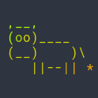

# Hello!

I'm Kai En, an aspiring hardware/software ~~gremlin~~ developer based in Singapore. 
I'm studying Computer Engineering at SUTD.

I have a more polished portfolio page [here](https://muikaien.com).

After ~~three~~ five(?) years of neglect, I've given up maintaining this site for outward appearances. This domain is now home to my other random stuff. 

Check out my [GitHub](https://github.com/kaine119) page!

## Some things I do

* Python, Ruby, JavaScript, C#, Java
* Web development
	- Frontend: HTML/CSS/JS, Vue.JS, AngularJS 1.x, Bulma.css, Bootstrap
	- Backend: Flask, Sinatra, ExpressJS
	- Static site generators: Jekyll (you're looking at one right now!)
	- Cloud deployment: Heroku (and maybe AWS, MS Azure)
* Native stuff
  - have worked on a .NET WPF project
  - previously worked on a few Android applications
* IRL stuff
  - 3D modelling / CAD
  - PCB ECAD
  - Microcontroller development on STM32 / Arduino / ESP32 with C
  - drones
